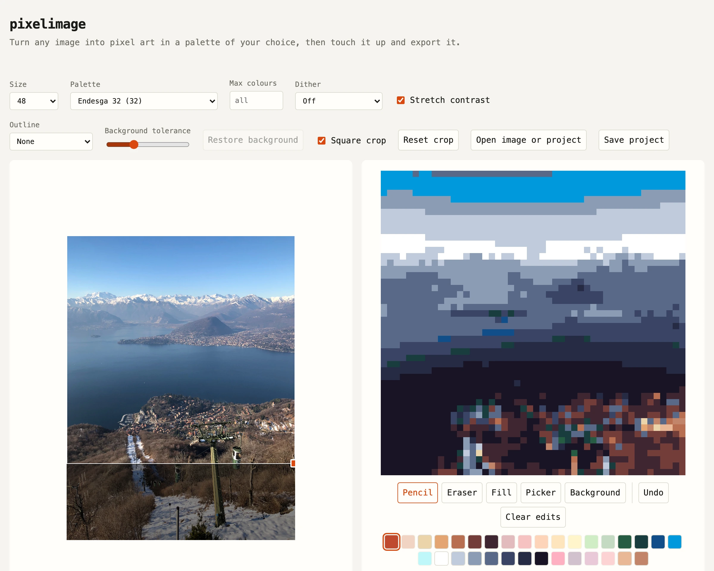

# pixelimage

Turn any image into palette-limited pixel art, touch it up and export it.

**→ [pixelimage.sirlisko.com](https://pixelimage.sirlisko.com)**



It's for making your own art from a starting point, not just filtering a photo: convert, clean up, then finish in Aseprite or wherever you draw.

- **Load.** Drop, paste or pick an image, then crop it to a square or any area.
- **Convert.** Pick a size (16–64, or anything up to 256) and a palette: consoles and computers (Game Boy, NES, Master System, Commodore 64, ZX Spectrum, PICO-8 and more), artist palettes (Endesga, DawnBringer, Sweetie 16, AAP-64, Resurrect 64), or any [Lospec](https://lospec.com/palette-list) palette by name or link. Stretch the contrast, dither with Floyd–Steinberg or Bayer, and cap the number of colours.
- **Sprite tools.** Click the background to make it transparent, and add a 1px outline in any palette colour.
- **Edit.** Pencil, eraser, fill and colour picker, limited to the palette, with undo (⌘/Ctrl+Z). Colours the image doesn't use are faded, so you can see what the conversion picked. Shortcuts follow Aseprite: B, E, G, I, and W for the background. Edits are kept per crop, size and palette, so changing other settings keeps them.
- **Export.** A PNG at 1× or scaled up, and the palette as a `.gpl` for Aseprite, GIMP or Krita.
- **Save.** Your work is kept in the browser and comes back when you reopen the page. Save it as a project file to keep it or move it elsewhere.

Everything runs in the browser; images never leave your machine.

## How it works

1. The crop is downscaled by averaging every source pixel under each output pixel, in linear light with premultiplied alpha.
2. Lightness is stretched so the 1st–99th percentile of the image (the foreground, if the background was removed) spans the full range.
3. Each pixel takes the nearest palette colour in OKLab. Palettes that are shades of one hue, like the Game Boy's, are matched by lightness alone, spread over their darkest-to-lightest range.
4. Dithering skips flat areas, where it turns gradients into checkerboards, and strong edges, where it leaves halos.
5. The colour cap drops the least-used colour into its nearest neighbour until few enough are left, then converts again with only those.

## Development

```sh
pnpm install
pnpm dev
pnpm test
```
